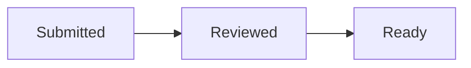

# Library pickup instructions

This fictional library example explains how to collect reserved books. Choose a pickup location and wait for a ready notice before travelling.

## Collection deadline

Uncollected books return to the shelf after 3 days. A ready notice does not extend this deadline.

## How to collect

1. Submit a request with your name and pickup location.
2. Wait for the library to review the request and send a ready notice.
3. Bring your library card when collecting the books.

## Pickup locations

| Location | Limit | Hours |
|---|---|---|
| North desk | 2 books | 09:00 to 12:00 |
| South desk | 5 books | 13:00 to 17:00 |
| Mobile stop | 1 book | 15:00 to 16:00 |

## Request progress

Reference link for this fictional example: [Pickup information](https://example.org/pickup)
